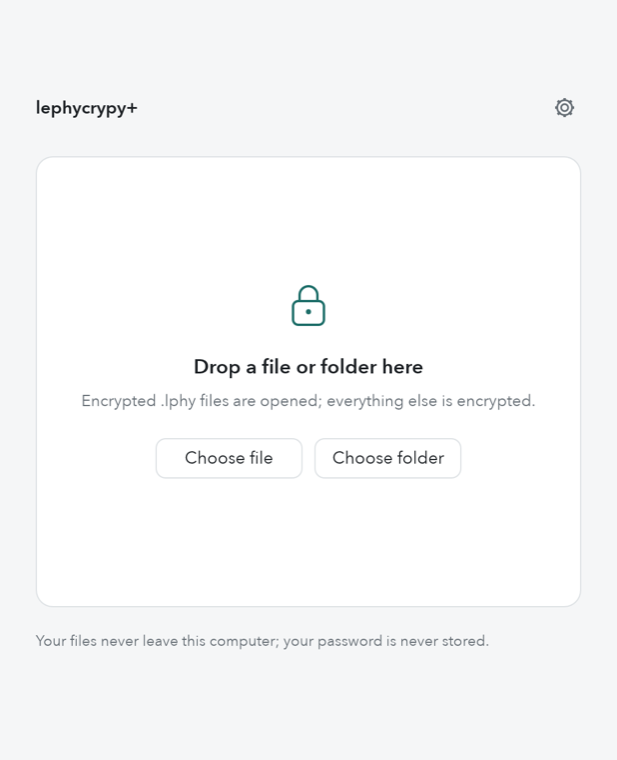
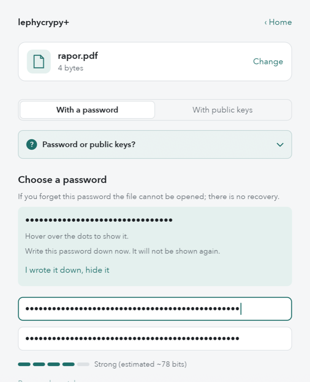
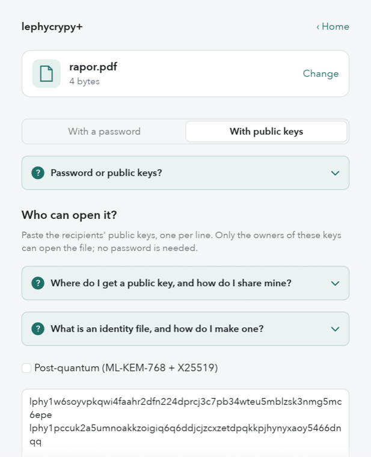
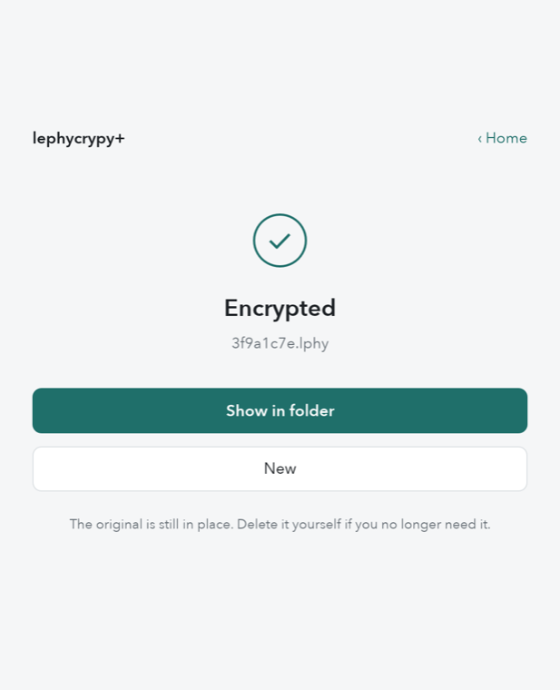

# lephycrypy+

[Türkçe](README.tr.md) · English

An open-source file and folder encryption tool written in Rust. Encrypt with a password or to
other people's public keys; file names and folder structure are always encrypted; large files are
streamed; output is written atomically; secrets in memory are kept to a minimum on a **best
effort** basis.

> **Status: pre-1.0.** lephycrypy+ has not had an independent security audit. Do not use it as
> the only copy of important data. The file format is specified in [docs/FORMAT.md](docs/FORMAT.md),
> the security boundaries in [docs/THREAT-MODEL.md](docs/THREAT-MODEL.md).

<p>
  
  
  
  
</p>

## Features

- **Files and folders** become one `.lphy` archive: names, structure and (by default) size are
  hidden. XChaCha20-Poly1305 or AES-256-GCM, Argon2id key derivation (512 MiB by default).
- **Password or public keys.** Use a password (optionally plus a key file), or encrypt to one or
  more X25519 public keys so only their owners can open the file — no shared password needed;
  optionally post-quantum (ML-KEM-768 + X25519), with sender signatures (Ed25519), a 22-word
  paper backup of your identity and changing the recipients later.
- **Batch encryption.** Several files or folders at once, each to its own `.lphy`.
- **Damage tolerance.** Optional Reed–Solomon error correction repairs damage from failing USB
  sticks and disks; a recovery mode saves what can be saved from a damaged file.
- **Practical extras.** Split output into parts (e.g. for FAT32), optional compression,
  passphrase and key-file generators, secure deletion of originals after verification (with
  confirmation and honest limits), `rekey` and `reencrypt`.
- **USB mode.** Wipe a removable USB stick and write only the encrypted file to it, with identity
  checks before every destructive step.
- **Desktop app** for macOS and Windows in English and Turkish: drag and drop, double-click `.lphy`
  files, and optional right-click entries (a Finder Quick Action, an Explorer menu entry).
- **Engineering.** All `unsafe` code in one small crate; format checked byte for byte against an
  independent Python reference; fuzzing; `cargo deny`, `cargo audit` and `cargo vet` in CI.

See [docs/COMPARISON.md](docs/COMPARISON.md) for how it relates to age, Picocrypt, VeraCrypt and
Cryptomator.

## Platforms

| Platform | Status |
|---|---|
| macOS (aarch64, x86_64) | supported |
| Windows (x86_64) | supported |
| Linux | builds, best effort; no `usb` and no desktop app |

MSRV: Rust 1.95.0 (pinned in `rust-toolchain.toml`).

## Command line

```bash
lephycrypy encrypt Documents/ -o a1b2c3d4.lphy
```

```bash
lephycrypy decrypt a1b2c3d4.lphy -o Documents
```

Files and folders are always written as an **archive**: names and structure are encrypted and
the size is rounded with PADMÉ (`--no-pad` turns this off). A single-file archive is decrypted
straight to the destination file. `encrypt -` (stdin) and `--raw` write a raw stream (`--pad`
pads a raw stream too; not with stdin). Symbolic links are not restored by default:
`--restore-symlinks` restores only relative targets without `..`, `--restore-symlinks unsafe`
restores all. `--strict` treats every skipped or changed entry as an error; `--rename-conflicts`
adds `_2` on case conflicts. Extracting into a known cloud-sync folder asks first
(`--allow-cloud-dir`).

Defaults: XChaCha20-Poly1305, 1 MiB chunks, Argon2id 512 MiB / 3 / 4. Options include
`--alg aes256gcm`, `--chunk-size 64k|256k|1m|4m|16m`, `--kdf-memory/--kdf-time/--kdf-parallelism`,
`--keyfile`, `--force`, `--strict-memory`, `--stdout` (raw streams only) and `--allow-large-kdf`.

| Task | Command |
|---|---|
| Several sources, one `.lphy` each | `lephycrypy encrypt a.pdf photos/ notes.txt --out-dir out/` |
| Compress first (see the side-channel note in FORMAT.md) | `encrypt … --compress` |
| Add error correction (~7 % larger) | `encrypt … --error-correction` |
| Split into parts | `encrypt … --split-size 650m` (decrypt the `.001` file) |
| Delete the originals after verification | `encrypt … --delete-original` or `--secure-delete` |
| Recover what is readable from a damaged file | `decrypt damaged.lphy --recover` |
| Check without writing | `lephycrypy verify file.lphy` |
| List an archive without extracting | `lephycrypy list file.lphy` |
| Extract only some paths | `decrypt file.lphy --only docs/ --only notes.txt` |
| Show unencrypted header data | `lephycrypy info file.lphy` |
| Change the password (same file key) | `lephycrypy rekey file.lphy` |
| Change the password and the file key | `lephycrypy reencrypt file.lphy` |
| Generate a passphrase / key file | `lephycrypy passphrase`, `lephycrypy keyfile-gen key.bin` |
| Remove leftover temporary files | `lephycrypy cleanup DIR` |

### Public keys

```bash
lephycrypy keygen me.lphykey
```

This writes your password-protected identity to `me.lphykey` and your public key (`lphy1…`) to
`me.pub` and to the screen. Share only the public key.

```bash
lephycrypy encrypt report.pdf -o report.lphy -r lphy1… -r friend.pub
```

```bash
lephycrypy decrypt report.lphy -i me.lphykey
```

Any listed recipient can open the file; the password asked for is the identity file's. Public
keys carry a checksum, so a mistyped key is rejected.

To change who can open a file, any current recipient replaces the whole list (public keys are not
stored in the file, so give everyone who keeps access, yourself included):

```bash
lephycrypy recipients report.lphy -i me.lphykey -r me.pub -r new-colleague.pub
```

The content is not re-encrypted; a removed recipient who kept a copy of the old file can still
open that copy.

For protection against future quantum computers, encrypt to the recipients' post-quantum keys
(ML-KEM-768 together with X25519; the third line of their `.pub` file):

```bash
lephycrypy encrypt report.pdf -o report.lphy --pq -r friend.pub
```

In the app, tick **Post-quantum** under "With public keys".

Sign what you send, so recipients know it came from you and was not changed:

```bash
lephycrypy encrypt report.pdf -o report.lphy -r friend.pub --sign me.lphykey
```

```bash
lephycrypy decrypt report.lphy -i friend.lphykey --expect-signer me.pub
```

The signer key (`lphysig1…`) is printed by `keygen` and stored as the second line of `me.pub`.
Signing works for password files too; in the app it is **Sign with my identity** in the advanced
settings, and the result screen shows who signed a file.

Keep a paper backup of your identity: `lephycrypy identity backup me.lphykey` shows 22 words (the
app shows them once, right after it creates a key pair), and
`lephycrypy identity restore me.lphykey` recreates the identity file from them. Anyone with the
words can open every file encrypted to that key. An identity file itself is never decrypted. In the app: **Change the recipient list…** on the identity screen.

### Password sources

Passwords are **never** read from argv or environment variables. For scripts there are
`--password-stdin` (all platforms), `--password-fd <n>` (Unix only) and `--password-file <path>`.
A plaintext password file stays on disk; prefer tmpfs, a RAM disk or a named pipe. On Windows only
local (`\\.\pipe\…`) pipes owned by the same user are accepted.

## Writing to a USB stick

```bash
lephycrypy usb list
```

```bash
lephycrypy usb write backup.lphy --target /Volumes/USBSTICK
```

Only **USB-bus, removable media** are accepted; internal, virtual, system and Time Machine
volumes and external USB SSDs/HDDs that report as "fixed" are refused (code 1; no flag overrides
this). On Windows, devices without a serial number are refused too. The command shows what will
be erased, then asks you to type the volume label **and** its size in GiB (`--confirm-label` and
`--confirm-size-gib` in scripts); a mismatch is code 5 and nothing is erased. The device identity
is re-read before every step; if it changed, the command stops with code 5. Only valid `.lphy`
files are written. `--format` formats the volume as exFAT (an administrator session is needed on
Windows), `--fill-free-space` fills free space with random data. FAT/exFAT directory remnants,
NTFS resident files and wear levelling mean physical erasure is not guaranteed.

## Desktop app

`lephycrypy-gui` (macOS and Windows) is a single, simple window. The first launch shows a short
welcome; after that the start screen has four cards — **Encrypt**, **Decrypt**, **My keys**
(create a key pair, show the public keys of an identity, take its paper backup) and **Settings** —
and a drop area.

1. Drop files or folders on the window, or use the **Encrypt** / **Decrypt** cards. `.lphy` files
   are opened; everything else is encrypted.
2. Choose **With a password** or **With public keys**. A password is asked twice and must be at
   least 8 characters; a strength estimate and a passphrase generator help. With public keys,
   paste the recipients' keys or create your own key pair.
3. Change the destination if needed and press **Encrypt** or **Decrypt**.
4. When it is done, **Show in folder** opens the result in Finder or Explorer.

On macOS, double-clicking a `.lphy` file opens it in the app, and any file or folder can be
opened with **Open With → lephycrypy+**.

Closing the window does not stop a running job: on macOS the close button hides the app and the
Dock icon brings it back; the app quits only with Cmd+Q or Dock → Quit, which asks first while a
job runs (the job is then cancelled and the partial file deleted). On Windows, closing while a job
runs minimises the window.

**Settings:**

- **Language:** English or Turkish (the system language until you choose).
- **App lock** (off by default): when you turn it on, the app asks for a password every time it
  starts. It only keeps others from using the app; encrypted files are protected by their own
  passwords and keys. Forgetting it is not fatal: delete the settings file to remove the lock.
- **Finder Quick Action** (macOS, app bundle only): adds "Encrypt or open with lephycrypy+" under
  **Quick Actions** in Finder's right-click menu. It is a small workflow in
  `~/Library/Services` for the current user that only opens the selected items in the app.
- **Explorer integration** (Windows): for the current user only, `.lphy` files open with a
  double-click and every file and folder gets a right-click entry.

Both integrations are added and removed only after confirmation. The app saves only the language,
whether the welcome screen was seen and, if the lock is on, its verifier (Argon2id) — in
`~/Library/Application Support/lephycrypy+/settings` (Windows: `%APPDATA%\lephycrypy+`); no file
names or passwords.
Shortcut: Cmd+O (Ctrl+O on Windows) opens the file picker.

The password field is masked, copy and paste are disabled and the text is kept in locked memory.
**Advanced settings** offer the algorithm, password-derivation memory, size hiding, compression,
error correction, splitting, secure deletion and an optional key file; the **?** button explains
the terms. For an encrypted archive, **List contents** shows what is inside without writing
anything; tick entries to extract only those. The app follows the system light/dark theme.

## Building

```bash
cargo build --locked
```

```bash
cargo test --locked --workspace
```

Desktop app:

```bash
cargo run --release -p lephy-gui
```

macOS app bundle (`target/macos/lephycrypy+.app`) and optional disk image:

```bash
scripts/macos-app.sh --dmg
```

The bundle is signed ad hoc; it opens without warnings only on the Mac that built it.
`--dmg` also writes `<image>.sha256`.

### Verify your download

Releases are not notarized by Apple or signed with a Windows code-signing certificate yet, so
the operating system cannot tell you who made them. Check the file against the checksum
published with the release (`SHA256SUMS*.txt`, or the `.sha256` next to a disk image) before
opening it:

```bash
shasum -a 256 -c lephycrypy-plus-0.0.1.dmg.sha256
```

On Windows (PowerShell), compare the output with the published value:

```powershell
Get-FileHash .\lephycrypy.exe -Algorithm SHA256
```

A checksum only helps if you got it from a different place than the file, or over a channel you
trust (the release page on GitHub over HTTPS).

Fuzz targets live in `fuzz/` (a separate workspace; nightly and `cargo-fuzz`). Format vectors are
compared byte for byte with a Python reference written only from FORMAT.md
(`tests/ref/lephy_ref.py`): `cargo test -p lephy-core --features test-vectors`.

## Crates

| Crate | Role | unsafe |
|---|---|---|
| `lephy-sys` | the only FFI/unsafe crate: memory locking, process hardening, file system, volumes, terminal, signals, OS integration | yes, every block has a `// SAFETY:` comment |
| `lephy-core` | cryptography, format, archive, pipeline | `#![forbid(unsafe_code)]` |
| `lephy-cli` | the `lephycrypy` command | `#![forbid(unsafe_code)]` |
| `lephy-usb` | removable USB only: eligibility, confirmation, identity re-checks, wipe/format, fill, write, read-back | `#![forbid(unsafe_code)]` |
| `lephy-gui` | `lephycrypy-gui`: egui/eframe single window (macOS/Windows) | `#![forbid(unsafe_code)]`; zeroizing global allocator |

## Exit codes

| Code | Meaning |
|---|---|
| 0 | success |
| 1 | I/O, environment or general error |
| 2 | usage error (argument parsing only) |
| 3 | wrong password, key file or identity |
| 4 | damaged file / format violation |
| 5 | cancelled by the user / confirmation mismatch |
| 6 | key-derivation budget or RAM insufficient (`--allow-large-kdf`) |
| 7 | destination exists (`--force`) |
| 8 | disk space / FAT32 4 GiB limit |
| 130 | SIGINT/SIGTERM/Ctrl+C (also 130 on Windows, deliberately instead of 0xC000013A) |

## Memory limits

Small secrets are locked with `mlock`/`VirtualLock`; failure is a warning, or an error with
`--strict-memory`. `RLIMIT_MEMLOCK` (Unix) and the working-set limit (Windows) can prevent
locking. Hibernation, swap/pagefile and OS background services are covered in
docs/THREAT-MODEL.md.

## Debugging

Release binaries use `PT_DENY_ATTACH` on macOS; `--allow-debugger` does not allow attaching a
debugger to a notarized binary. Use a local unsigned build for debugging.

## Security

Please report vulnerabilities privately as described in [SECURITY.md](SECURITY.md). Changes are listed in [CHANGELOG.md](CHANGELOG.md).

## License

lephycrypy+ is licensed under the [Apache License 2.0](LICENSE) only.

Attribution is required: every copy, modified version or other derivative work that is
distributed — commercial or personal, in source or binary form — must keep the [LICENSE](LICENSE)
and [NOTICE](NOTICE) files and credit **lephycrypy+ contributors**
(https://github.com/Seesternn/lephycrypy-plus). Modified files must say that they were changed.
If you use or fork the project, please credit it the same way. See NOTICE for third-party
content.
