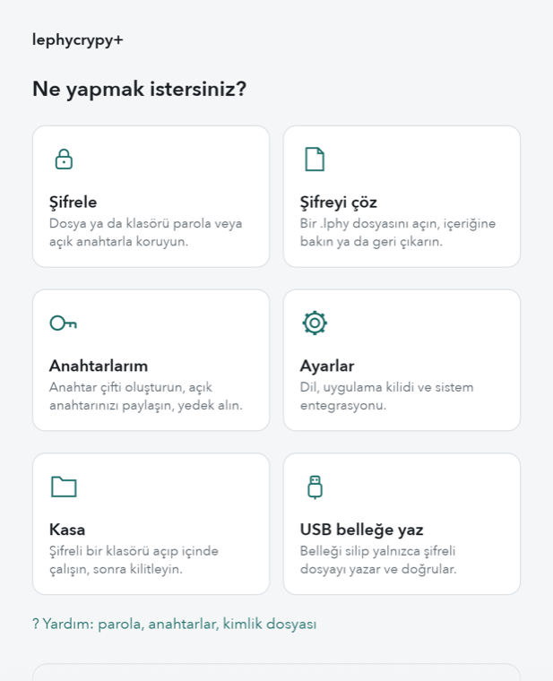
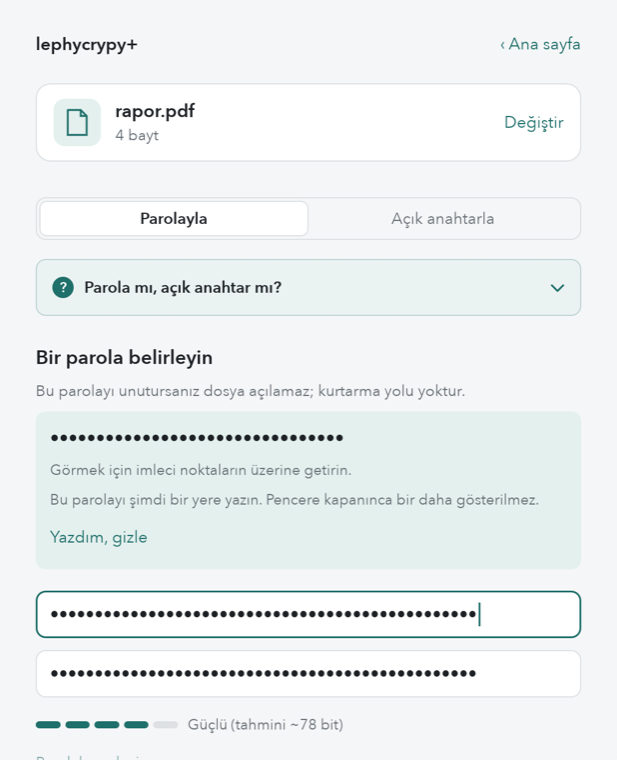
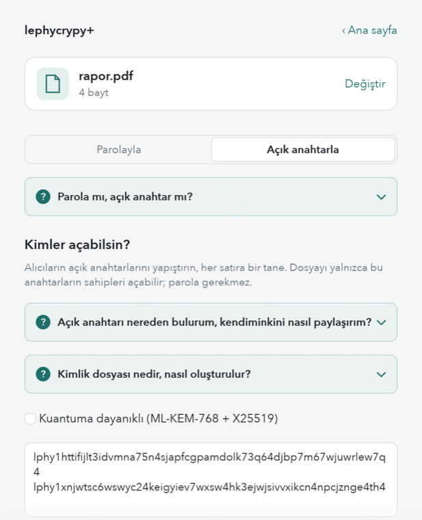
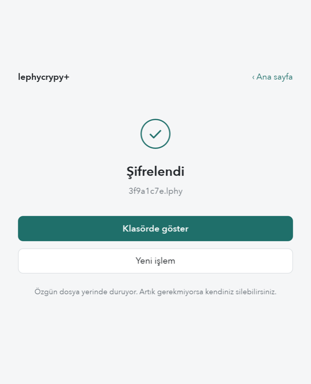
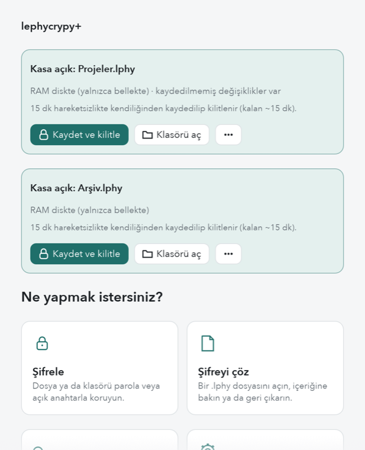
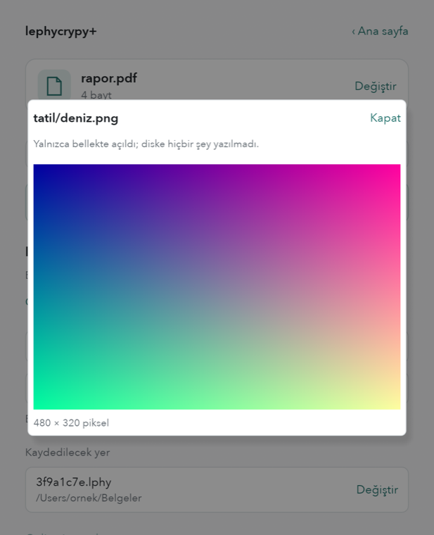
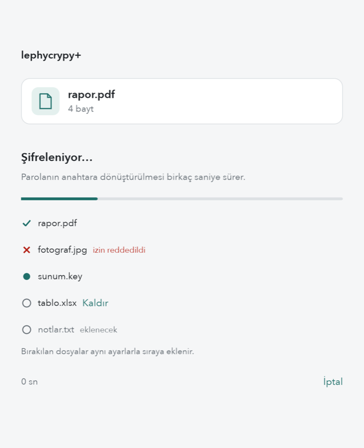
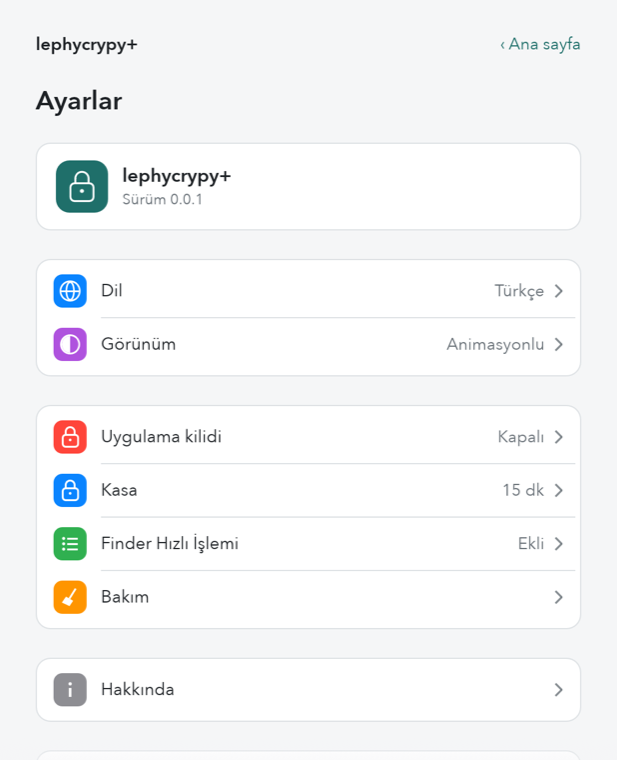

# lephycrypy+

Türkçe · [English](README.md)

Rust ile yazılmış, açık kaynaklı dosya ve klasör şifreleme aracı. Parolayla ya da başka
kişilerin açık anahtarlarına şifreler; dosya adları ve klasör yapısı her zaman şifrelidir; büyük
dosyalar akış hâlinde işlenir; çıktı atomik yazılır; bellekteki sırlar **en iyi çabayla** en aza
indirilir.

> **Durum: 1.0 öncesi.** Bağımsız bir güvenlik denetiminden geçmemiştir; önemli verilerinizin tek
> kopyası için kullanmayın. Biçim [docs/FORMAT.md](docs/FORMAT.md)'de, güvenlik sınırları
> [docs/THREAT-MODEL.md](docs/THREAT-MODEL.md)'de anlatılır (İngilizce).

<p>
  
  
  
  
</p>
<p>
  
  
  
  
</p>

## Özellikler

- **Dosya ve klasörler** tek bir `.lphy` arşivi olur: adlar, yapı ve (varsayılan olarak) boyut
  gizlenir. XChaCha20-Poly1305 ya da AES-256-GCM, Argon2id anahtar türetme (varsayılan 512 MiB).
- **Parola ya da açık anahtar.** Parola (isteğe bağlı anahtar dosyasıyla) ya da bir veya birden çok
  X25519 açık anahtarı: dosyayı yalnızca anahtar sahipleri açar, ortak parola gerekmez. İsteğe
  bağlı olarak kuantuma dayanıklı (ML-KEM-768 + X25519); gönderen imzası (Ed25519), kimliğin
  22 kelimelik kâğıt yedeği ve alıcıları sonradan değiştirme.
- **Toplu şifreleme.** Birden çok dosya ya da klasör, her biri ayrı bir `.lphy`.
- **Hasara dayanıklılık.** İsteğe bağlı Reed–Solomon hata düzeltme, bozulan USB bellek ve
  disklerdeki hasarı onarır; kurtarma modu bozuk dosyadan kurtarılabileni çıkarır.
- **Pratik ekler.** Parçalara bölme (ör. FAT32 için), sıkıştırma, parola ve anahtar dosyası
  üretici, doğrulamadan sonra orijinali güvenli silme (onaylı, sınırları açıkça belirtilerek),
  `rekey` ve `reencrypt`.
- **USB modu.** Çıkarılabilir USB belleği temizleyip yalnızca şifreli dosyayı yazar; her yıkıcı
  adımdan önce aygıt kimliğini yeniden denetler.
- **Masaüstü uygulaması** (macOS ve Windows, Türkçe ve İngilizce): sürükle-bırak, `.lphy`
  dosyasına çift tıklama, isteğe bağlı sağ tık girişleri (Finder Hızlı İşlemi, Gezgin menüsü).
- **Kasalar.** Şifreli bir klasörü bir kez açıp içinde çalışın, sonra kaydedip yeniden
  kilitleyin; macOS'ta açık kopya bir RAM diskte durur. Aynı anda istediğiniz kadar kasa açık
  olabilir; kasa parolayla ya da açık anahtarlarla kilitlenir; her USB bellek kasa olabilir.
  Bilgisayarın başında değilken, ekran kilitlenince, uykudan önce, pencere kapatılınca ya da
  klasörü kapatılınca kendiliğinden kaydedilip kilitlenir.
- **QR kod:** anahtarın kâğıt yedeği için (macOS'ta yazdırma ile) ve açık anahtarı telefonla
  paylaşmak için.
- **Diske yazmadan önizleme.** Şifreli bir metin, PNG ya da JPEG'e bellekte bakın; diske hiçbir
  şey yazılmaz.
- **Kuyruk.** Birden çok dosya sırayla, her birinin durumu görünerek işlenir; iş sürerken yenileri
  eklenebilir, başarısızlar yeniden denenebilir.
- **Güvenlik ağları.** İndirilmiş dosyalar çözüldükten sonra indirme işaretini korur (Gatekeeper /
  SmartScreen programları yine denetler), yarıda kalan bir şifre çözmenin artıkları bulunup
  silinmesi önerilir, ekrandaki gizli bilgiler ekran görüntüsünden ve paylaşımından gizlenir.
- **Mühendislik.** Tüm `unsafe` kod tek küçük crate'te; biçim bağımsız bir Python referansıyla bayt
  bayt karşılaştırılır; fuzz testleri; CI'da `cargo deny`, `cargo audit` ve `cargo vet`.

age, Picocrypt, VeraCrypt ve Cryptomator ile karşılaştırma: [docs/COMPARISON.md](docs/COMPARISON.md).

Adım adım nasıl çalıştığı: şifreleme, şifre çözme, kasalar, USB bellekler ve anahtar çiftlerinin [akış şemaları](https://seesternn.github.io/lephycrypy-plus/tr/) ([English](https://seesternn.github.io/lephycrypy-plus/en/)).

## Platformlar

| Platform | Durum |
|---|---|
| macOS (aarch64, x86_64) | desteklenir |
| Windows (x86_64) | desteklenir |
| Linux | derlenir, en iyi çaba; `usb` ve masaüstü uygulaması yok |

MSRV: Rust 1.95.0 (`rust-toolchain.toml` ile sabit).

## Komut satırı

```bash
lephycrypy encrypt Belgeler/ -o a1b2c3d4.lphy
```

```bash
lephycrypy decrypt a1b2c3d4.lphy -o Belgeler
```

Dosya ve klasörler her zaman **arşiv** olarak yazılır: adlar ve yapı şifrelidir, boyut PADMÉ ile
yuvarlanır (`--no-pad` kapatır). Tek dosyalık arşiv çözülürken dosya doğrudan hedefe yazılır.
`encrypt -` (stdin) ve `--raw` ham akış üretir. Symlink'ler varsayılan olarak kurulmaz
(`--restore-symlinks`). Bilinen bulut senkron klasörlerine çıkarma onay ister.

| İş | Komut |
|---|---|
| Birden çok kaynak, her biri ayrı `.lphy` | `lephycrypy encrypt a.pdf fotograflar/ not.txt --out-dir cikti/` |
| Önce sıkıştır | `encrypt … --compress` |
| Hata düzeltme ekle (~%7 büyür) | `encrypt … --error-correction` |
| Parçalara böl | `encrypt … --split-size 650m` (çözerken `.001` dosyası verilir) |
| Doğrulamadan sonra orijinali sil | `encrypt … --delete-original` ya da `--secure-delete` |
| Bozuk dosyadan kurtarılabileni çıkar | `decrypt bozuk.lphy --recover` |
| Yazmadan doğrula | `lephycrypy verify dosya.lphy` |
| Arşivi çıkarmadan listele | `lephycrypy list dosya.lphy` |
| Yalnızca bazı yolları çıkar | `decrypt dosya.lphy --only belgeler/ --only not.txt` |
| Şifresiz başlık bilgisi | `lephycrypy info dosya.lphy` |
| Parolayı değiştir (dosya anahtarı aynı) | `lephycrypy rekey dosya.lphy` |
| Parolayı ve dosya anahtarını değiştir | `lephycrypy reencrypt dosya.lphy` |
| Parola / anahtar dosyası üret | `lephycrypy passphrase`, `lephycrypy keyfile-gen anahtar.bin` |

### Açık anahtarlar

```bash
lephycrypy keygen ben.lphykey
```

Parolayla korunan kimliğiniz `ben.lphykey` dosyasına, açık anahtarınız (`lphy1…`) `ben.pub`
dosyasına ve ekrana yazılır. Yalnızca açık anahtarı paylaşın.

```bash
lephycrypy encrypt rapor.pdf -o rapor.lphy -r lphy1… -r arkadas.pub
```

```bash
lephycrypy decrypt rapor.lphy -i ben.lphykey
```

Dosyayı kimin açabileceğini değiştirmek için mevcut alıcılardan biri listenin tamamını yeniler.
Açık anahtarlar dosyada saklanmadığından, erişimi kalacak herkesi (kendiniz dahil) verin:

```bash
lephycrypy recipients rapor.lphy -i ben.lphykey -r ben.pub -r yeni-is-arkadasi.pub
```

İçerik yeniden şifrelenmez; çıkarılan biri eski dosyanın bir kopyasını sakladıysa onu açabilir.

Gelecekteki kuantum bilgisayarlara karşı koruma için alıcıların kuantuma dayanıklı anahtarlarına
şifreleyin (ML-KEM-768 ile X25519 birlikte; `.pub` dosyalarının üçüncü satırı):

```bash
lephycrypy encrypt rapor.pdf -o rapor.lphy --pq -r arkadas.pub
```

Uygulamada "Açık anahtarla" altında **Kuantuma dayanıklı** kutusunu işaretleyin.

Gönderdiğinizi imzalayın; alıcı sizden geldiğini ve değiştirilmediğini bilsin:

```bash
lephycrypy encrypt rapor.pdf -o rapor.lphy -r arkadas.pub --sign ben.lphykey
```

```bash
lephycrypy decrypt rapor.lphy -i arkadas.lphykey --expect-signer ben.pub
```

İmza anahtarı (`lphysig1…`) `keygen` tarafından yazdırılır ve `ben.pub` dosyasının ikinci
satırında durur. İmza parolalı dosyalarda da çalışır; uygulamada gelişmiş ayarlardaki
**Kimliğimle imzala** seçeneğidir, sonuç ekranı dosyayı kimin imzaladığını gösterir.

Kimliğinizin kâğıt yedeğini alın: `lephycrypy identity backup ben.lphykey` 22 kelime gösterir
(uygulama da anahtar çiftini oluşturduktan hemen sonra bir kez gösterir);
`lephycrypy identity restore ben.lphykey` kimlik dosyasını bu kelimelerden yeniden oluşturur.
Kelimelere sahip olan herkes o anahtara şifrelenen her dosyayı açabilir. Kimlik dosyasının kendisi
hiçbir zaman çözülmez.
Uygulamada: kimlik ekranında **Alıcı listesini değiştir…**.

Parola argv'den ya da ortam değişkeninden **asla** okunmaz; betikler için `--password-stdin`,
`--password-fd` (Unix) ve `--password-file` vardır.

## USB belleğe yazma

```bash
lephycrypy usb write yedek.lphy --target /Volumes/USBBELLEK
```

Yalnızca USB veriyolundaki çıkarılabilir ortamlar kabul edilir. Komut silinecekleri gösterir,
birim etiketini ve boyutu aynen yazmanızı ister; her adımdan önce aygıt kimliği yeniden okunur.
Ayrıntılar İngilizce README'dedir.

## Masaüstü uygulaması

İlk açılışta üç adımlı kısa bir tanıtım çıkar. Sonrasında açılış ekranında altı kart vardır:
**Şifrele**, **Şifreyi çöz**, **Anahtarlarım** (anahtar çifti oluşturma, bir kimliğin açık
anahtarlarını gösterme — QR kod olarak da — kâğıt yedeğini QR koduyla alma, macOS'ta yazdırma
ya da ondan geri yükleme), **Ayarlar**, **Kasa** ve
**USB belleğe yaz**. Altında bir bırakma alanı bulunur. Her ekranda kısa **?** yardım kutuları
vardır; açılış ekranındaki **Yardım** hepsini bir arada gösterir.

1. Dosya ya da klasörleri pencereye bırakın veya **Şifrele** / **Şifreyi çöz** kartlarını kullanın.
   `.lphy` dosyaları açılır, diğer her şey şifrelenir.
2. **Parolayla** ya da **Açık anahtarla** seçin. Parola iki kez istenir ve en az 8 karakter
   olmalıdır; güç tahmini ve parola üretici yardımcı olur. Açık anahtarla şifrelerken alıcıların
   anahtarlarını yapıştırın ya da kendi anahtar çiftinizi oluşturun.
3. Gerekirse kayıt yerini değiştirip **Şifrele** ya da **Şifreyi çöz**'e basın. Çözülen dosya
   özgün adıyla geri gelir (`.lphy` dosyasının rastgele adıyla değil, örneğin `foto.png` olarak).
4. İş bitince **Klasörde göster** sonucu Finder'da ya da Gezgin'de açar.

Şifre çözme ekranında **Önizle (diske yazmadan)** bir metni, PNG'yi ya da JPEG'i bellekte gösterir;
**Diğer işlemler** altında **Yalnızca doğrula**, **Parolayı değiştir** ve **Dosya anahtarını
yenile** vardır.

macOS'ta `.lphy` dosyasına çift tıklamak onu uygulamada açar; her dosya ya da klasör **Birlikte
Aç → lephycrypy+** ile açılabilir.

Pencereyi kapatmak süren bir işi durdurmaz. macOS'ta kırmızı düğme uygulamayı gizler, Dock
simgesi geri getirir. Uygulama yalnızca Cmd+Q ya da Dock → Çık ile kapanır; iş sürüyorsa önce
sorar (iş iptal edilir, yarım dosya silinir). Windows'ta iş sürerken kapatmak pencereyi simge
durumuna küçültür.

**Ayarlar**, sistem ayarlarındaki gibi kendi sayfalarını açan gruplanmış satırlardan oluşur.

- **Dil:** Türkçe ya da İngilizce (seçene kadar sistem dili).
- **Görünüm:** animasyonlar (sistemdeki "hareketi azalt" ayarına da uyar) ve açılış ekranındaki
  "Bu oturumda" listesi.
- **Uygulama kilidi** (varsayılan kapalı): açarsanız uygulama her başlatıldığında parola ister;
  yanlış parolada bekleme süresi her seferinde uzar. Yalnızca bu masaüstü uygulamasının
  kullanılmasını engeller (komut satırı aracını değil); şifreli dosyalar kendi parolaları ve
  anahtarlarıyla korunur. Kilit Anahtar Zinciri'nde de (Windows'ta Kimlik Bilgisi Yöneticisi'nde)
  saklanır; parolayı unutursanız oradaki "lephycrypy+" kaydını ve ayar dosyasını silin.
- **Kasa:** açık kasaları 5, 15 (varsayılan), 30 ya da 60 dakika hareketsizlikten sonra
  kilitleme ya da hiç kilitlememe; ayrıca her biri ayrı anahtarla: ekran kilitlenince (uykudan
  önce ve uyanınca da), pencere kapatılınca, çıkarken sormadan ve kasa klasörü kapatılınca.
- **Bakım:** bir klasörde yarıda kalan şifre çözmelerin artıklarını arama (ev klasörü,
  Masaüstü, İndirilenler ve Belgeler açılışta kendiliğinden taranır).
- **Finder Hızlı İşlemi** (macOS, yalnızca .app paketi): Finder'da sağ tık → **Hızlı İşlemler**
  altına "lephycrypy+ ile şifrele / aç" ekler. `~/Library/Services` içinde yalnızca geçerli
  kullanıcı için küçük bir iş akışıdır; seçilen öğeleri yalnızca uygulamada açar.
- **Gezgin entegrasyonu** (Windows): yalnızca geçerli kullanıcı için `.lphy` çift tıklamayla açılır,
  her dosya ve klasöre sağ tık girişi eklenir.

İki entegrasyon da yalnızca onaydan sonra eklenir ve kaldırılır. En alttaki **GitHub deposu** bu
projenin sayfasını açar. Uygulama yalnızca dili, yukarıdaki tercihleri, karşılama ekranının
görüldüğünü ve kilit açıksa doğrulayıcısını (Argon2id) kaydeder:
`~/Library/Application Support/lephycrypy+/settings` (Windows: `%APPDATA%\lephycrypy+`). Dosya
adı ya da parola kaydedilmez.

Şifreli bir arşivde **İçeriği listele**, hiçbir şey yazmadan içinde ne olduğunu gösterir; yalnızca
işaretlediğiniz öğeler çıkarılır.

### Kuyruk (masaüstü uygulaması)

Birden çok dosyayı bırakın ya da seçin; sırayla işlenir, her birinin durumu görünür ve bekleyen
bir öğe kaldırılabilir. Bir iş sürerken bırakılan dosyalar aynı parola ve ayarlarla kuyruğa
eklenir. Başarısız öğeler bitti ekranından yeniden denenebilir. Ana sayfa bu oturumdaki işleri
listeler; liste yalnızca bellekte tutulur.

### Kasa (masaüstü uygulaması)

Ana sayfa › **Kasa**: **Kasa aç…**, **Yeni boş kasa oluştur…** ya da **USB belleği kasa
yap…**. Klasör Finder'da / Gezgin'de açılır ve uygulamanın üstünde her açık kasa için bir kart
çıkar; kartta üç düğme vardır: **Kaydet ve kilitle** (yeniden şifreleyip açık kopyayı kaldırır),
**Klasörü aç** ve **⋯** (**Yalnızca kaydet**, **Kaydetmeden kapat…**). Aynı anda istediğiniz
kadar kasa açık olabilir. macOS'ta açık kopya bir RAM diskte (yalnızca bellekte; açık kasaların
toplamı belleğin en çok yarısını kullanabilir), Windows'ta gizli bir uygulama klasöründe durur
ve kasa kapatılınca üzerine yazılarak silinir.

Yeni bir kasa **parolayla** ya da **açık anahtarlarla** kilitlenir. Açık anahtarlarla kilitli
bir kasa kimlik dosyasıyla açılır; alıcı listesi kasanın içinde (`.lephy-recipients`, kasayla
birlikte şifreli) tutulur ve kartın **Alıcılar** düğmesiyle düzenlenir. Her kaydetmenin
doğrulanabilmesi için listede kendi anahtarınız kalmalıdır.

**USB bellekler.** "USB belleği kasa yap" ya belleğe bir kasa dosyası ekler ve diğer dosyaları
korur, ya da belleği önce siler (adını ve boyutunu yazdıktan sonra). Kasa içeren bir bellek
takılınca üstte bir şerit onu açmayı önerir (parola sorar; kendiliğinden hiçbir şey açılmaz).
Açık kopya bu bilgisayarın belleğinde durur; belleğe yalnızca kilitlerken şifreli dosya yazılır.
Kasası açıkken bellek çıkarılırsa kart kırmızıya döner ve **Başka yere kaydet…** önerir.

Kasalar, ayarlanan süre boyunca klavye ve fare kullanılmazsa (varsayılan 15 dakika), ekran
kilitlenince, bilgisayar uykuya geçmeden önce ve uyanınca, pencere kapatılınca, çıkarken ve
kasanın Finder / Gezgin penceresi kapatılıp içindeki hiçbir dosya açık değilken (30 saniye sonra;
macOS bunun için bir kez Finder'ı denetleme izni ister) kendiliğinden kaydedilip kilitlenir. Her
anın Ayarlar › Kasa'da ayrı bir anahtarı vardır. Denetimler pencere gizliyken de arka planda
çalışır. Bir çökme yüzünden açık kalan kasa bir sonraki açılışta bulunur.

### USB belleğe yazma (masaüstü uygulaması)

Ana sayfa › USB belleğe yaz: şifreli bir `.lphy` dosyası ve uygun bir USB bellek seçin, nelerin
silineceğine bakın (ya da "exFAT olarak biçimlendir" ve isterseniz "boş alanı doldur" seçeneklerini
işaretleyin), belleğin adını ve GiB cinsinden boyutunu aynen yazıp "Sil ve yaz"a basın. Dosya,
bellek yeniden bağlandıktan sonra geri okunarak denetlenir. Bellekteki diğer her şey silinir.

## Derleme

```bash
cargo build --locked
```

```bash
cargo test --locked --workspace
```

```bash
scripts/macos-app.sh --dmg
```

`--dmg`, disk görüntüsünün yanına `<görüntü>.sha256` dosyasını da yazar.

### İndirdiğiniz dosyayı doğrulayın

Sürümler henüz Apple tarafından onaylanmıyor (notarization) ve Windows kod imzalama sertifikasıyla
imzalanmıyor; bu yüzden işletim sistemi dosyayı kimin yaptığını size söyleyemez. Açmadan önce
dosyayı sürümle birlikte yayımlanan sağlama toplamıyla (`SHA256SUMS*.txt` ya da disk görüntüsünün
yanındaki `.sha256`) karşılaştırın:

```bash
shasum -a 256 -c lephycrypy-plus-0.0.1.dmg.sha256
```

Windows'ta (PowerShell) çıktıyı yayımlanan değerle karşılaştırın:

```powershell
Get-FileHash .\lephycrypy.exe -Algorithm SHA256
```

Sağlama toplamı, ancak onu dosyadan farklı bir yerden ya da güvendiğiniz bir kanaldan (GitHub
sürüm sayfası, HTTPS) aldıysanız işe yarar.

## Güvenlik

Zafiyetleri herkese açık issue olarak değil, [SECURITY.md](SECURITY.md)'deki yolla (İngilizce)
bildirin.

## Lisans

lephycrypy+ yalnızca [Apache License 2.0](LICENSE) ile lisanslanır.

Atıf zorunludur: dağıtılan her kopya, değiştirilmiş sürüm ya da türev çalışma (ticari ya da
kişisel, kaynak ya da ikili biçimde) [LICENSE](LICENSE) ve [NOTICE](NOTICE) dosyalarını korumalı ve
**lephycrypy+ contributors** adına atıf yapmalıdır (https://github.com/Seesternn/lephycrypy-plus).
Değiştirilen dosyalarda değiştirildikleri belirtilmelidir. Projeyi kullanıyor ya da çatallıyorsanız
lütfen aynı şekilde atıf yapın. Üçüncü taraf içerik için NOTICE.
